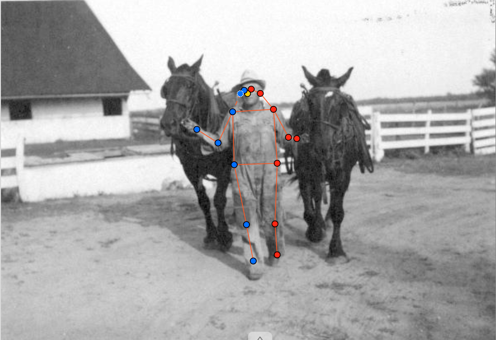
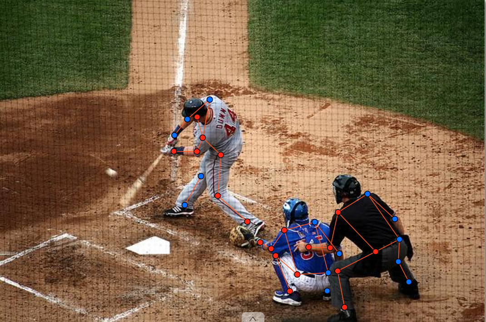
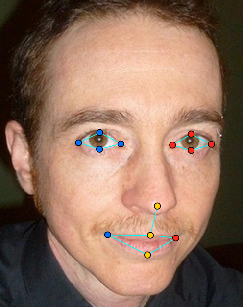
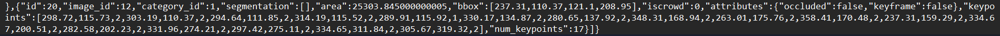

# Báo cáo cá nhân — Nguyen Thanh Tai

> Báo cáo này được tổng hợp từ mã nguồn, `src/exports/assignment.json`, hai file COCO xuất hiện có trong repo, thông tin buổi làm bài và ảnh chụp màn hình đã cung cấp.

## 0. Thông tin học viên

- Họ tên: Nguyen Thanh Tai
- MSSV: 202603038
- Email: thanhtai5223@gmail.com
- Link repository: https://github.com/NTT19/K5-L2-DAY04-NguyenThanhTai-2A202603038-KeypointPose.git
- Phiên bản CVAT (Help → About): Server version: 2.74.1, UI version: 2.74.1
- Máy: hệ điều hành Windows 11 · RAM 16 GB · chạy CVAT chế độ đầy đủ
- Bộ ảnh (`src/exports/assignment.json` do `lab.py setup` tạo): Có — `pool_version: d04-k5-v2`, gồm 12 ảnh người và 8 ảnh mặt
- Giờ bắt đầu: 16:00 12/11/2026
- Giờ kết thúc: 8:00 13/11/2026

## 1. Kiểm tra label (CP0)

| Label | Kiểu | Số điểm | Tên điểm đúng bảng của lab? | Đúng thứ tự? | Số cạnh |
|---|---|---:|---|---|---:|
| `person` | Skeleton | 17 | Có — file xuất được `check_submission.py` đọc đúng schema | Có — không có cảnh báo sai thứ tự | 19 |
| `face` | Skeleton | 13 | Có — file xuất được `check_submission.py` đọc đúng schema | Có — không có cảnh báo sai thứ tự | 13 |

Mẫu `person` dựng theo người quay mặt về camera (các điểm `left_*` nằm bên phải khung mẫu)? **Có theo mô tả/schema của lab.**

Cách đổi cờ `occluded` / `outside` cho **một điểm** trên phiên bản CVAT này: rê chuột đúng vào điểm cần đổi rồi nhấn `Q` để bật/tắt `occluded` hoặc `O` để bật/tắt `outside` (cũng có thể mở menu bằng chuột phải).

## 2. Số lượng đã gán và thời gian (CP1, CP2)

| Nhóm ảnh | Số ảnh | Số skeleton đã gán | Số người dưới 60 px (không gán) | Số poster / gương / màn hình bỏ qua | Thời gian (phút) |
|---|---:|---:|---:|---:|---:|
| `easy` | 5 | 5 | 0 được phát hiện trong file xuất* | 0 | 15 |
| `occluded` | 3 | 6 | 0 được phát hiện trong file xuất* | 0 | 10 |
| `back` | 2 | 4 | 0 được phát hiện trong file xuất* | 0 | 7 |
| `small` | 1 | 2 | 0 được phát hiện trong file xuất* | 0 | 3 |
| `crowd` | 1 | 3 | 0 được phát hiện trong file xuất* | 0 | 9 |
| `faces` | 8 | 8 | — | 0 | 30 |

Danh sách ảnh người theo `assignment.json`:

- `easy`: `000000019754.jpg`, `000000162046.jpg`, `000000196283.jpg`, `000000225138.jpg`, `000000429594.jpg`.
- `occluded`: `000000109010.jpg`, `000000177338.jpg`, `000000360811.jpg`.
- `back`: `000000069971.jpg`, `000000311300.jpg`.
- `small`: `000000106051.jpg`.
- `crowd`: `000000012552.jpg`.

- Số ảnh người đã xong ở mốc phút 105: 10 ảnh.
- Thời gian thực tế (phút): CP1 8 phút · CP2 3 phút · CP3 5p.
- Ảnh tốn thời gian nhất là ảnh nào, vì sao?
`000000012552.jpg` là ảnh `crowd`, có 3 skeleton và 18 điểm `v = 0`, nên là  cần nhiều thao tác nhất; thời gian thực tế 9p.

## 3. Bảng ca khó (CP1, CP2)

Trong khi gán nhãn, tôi tập trung kiểm tra các điểm bị che và các cặp trái/phải có nguy cơ bị đảo. Các ca dưới đây là những trường hợp tôi đã cân nhắc giữa `v = 1` và `v = 0`, hoặc phải kiểm tra lại hướng trái/phải.

| Ảnh | Người / mặt | Điểm | Cờ đã chọn | Phân vân giữa | Lý do chọn |
|---|---|---|---:|---|---|
| `000000311300.jpg` | person #2 | `left_ankle` / `right_ankle` | 2 | trái / phải | Script cảnh báo cặp cổ chân nằm ngược phía; kiểm tra lại theo phía giải phẫu của người và sửa lỗi `lr_swap`. |
| `000000109010.jpg` | person #1 | `left_elbow` | 1 | 0 / 1 | Ảnh thuộc nhóm `occluded`; điểm bị che nhưng vị trí vẫn có thể ước lượng theo thân và cánh tay. |
| `000000109010.jpg` | person #1 | `left_knee` | 1 | 0 / 1 | Vẫn xác định được vị trí khớp qua dáng chân dù bị che, nên chọn `occluded` thay vì `outside`. |
| `000000109010.jpg` | person #1 | `right_knee` | 1 | 0 / 1 | Điểm bị che nhưng có đủ ngữ cảnh để ước lượng, vì vậy giữ `v = 1`. |
| `000000225138.jpg` | person #1 | `left_eye` / `right_eye` | 1 | 0 / 1 | Vùng mắt khó quan sát nhưng vẫn ước lượng được vị trí, không hoàn toàn ngoài ảnh. |
| `face_99874.jpg` | face #1 | các điểm mắt trái/phải | 1 | 0 / 1 | Kính râm che vùng mắt; vị trí được ước lượng theo gọng kính nên dùng `occluded`. |
| `face_41666.jpg` | face #1 | `left_eye_outer`, `left_eye_upper`, `left_eye_lower` | 1 | 0 / 1 | Tóc che một phần mắt nhưng vẫn xác định được vùng mắt và mí, nên chọn `v = 1`. |
| `000000177338.jpg` | person #2 | `left_elbow` | 1 | 0 / 1 | Khớp tay bị che nhưng vẫn có thể suy ra từ phần cánh tay còn nhìn thấy. |

## 4. Bảng tự review (CP3)

Tôi thực hiện review từ ảnh cuối về ảnh đầu, kiểm tra các ảnh `crowd`, `back`, `occluded`, `easy` và ba ảnh mặt. Lỗi được ghi trước khi sửa; sau đó tôi sửa lại trên CVAT và chạy kiểm tra lại. Kết quả kiểm tra sau khi sửa: **0 lỗi, 0 cảnh báo — ĐẠT**.

| Ảnh | Người / mặt | Điểm | Mã lỗi | Ghi chú | Đã sửa? |
|---|---|---|---|---|---|
| `000000012552.jpg` | person #1, `crowd` | toàn skeleton | `ok` | Kiểm tra lại hướng và các điểm ngoài ảnh; không phát hiện lỗi cần sửa. | Không cần sửa |
| `000000069971.jpg` | person #1, `back` | toàn skeleton | `ok` | Đối chiếu các cặp trái/phải theo người quay lưng; không phát hiện lỗi. | Không cần sửa |
| `000000311300.jpg` | person #2, `back` | `left_ankle` / `right_ankle` | `lr_swap` | Cặp cổ chân nằm ngược phía so với các cặp còn lại; đã sửa theo cảnh báo của script. | Có |
| `000000360811.jpg` | person #1, `occluded` | toàn skeleton | `ok` | Kiểm tra các điểm bị che và điểm `outside`; không phát hiện lỗi cần sửa. | Không cần sửa |
| `000000429594.jpg` | person #1, `easy` | toàn skeleton | `ok` | Kiểm tra vị trí các điểm và cờ visibility; không phát hiện lỗi. | Không cần sửa |
| `face_99874.jpg` | face #1, `kinh_ram` | các điểm mắt | `ok` | Các điểm mắt bị kính râm che đã được giữ ở `v = 1` đúng quy tắc. | Không cần sửa |
| `face_41666.jpg` | face #1, `toc` | các điểm mắt trái | `ok` | Kiểm tra các điểm mắt bị tóc che; vị trí và cờ visibility phù hợp. | Không cần sửa |
| `face_436791.jpg` | face #1, `nghieng` | toàn skeleton | `ok` | Kiểm tra thứ tự trái/phải và vị trí 13 điểm mặt; không phát hiện lỗi. | Không cần sửa |

Tổng hợp số lỗi theo mã trong nhật ký tự review CP3:

| `lr_swap` | `vis_flag` | `position` | `missing` | `extra` | `ok` |
|---:|---:|---:|---:|---:|---:|
| 1 | 0 | 0 | 0 | 0 | 7 |

Điểm còn phân vân giữa `v = 1` và `v = 0`: các điểm bị che trong `000000109010.jpg`, `000000177338.jpg`, `000000225138.jpg` được chọn `v = 1` vì vẫn ước lượng được vị trí khớp; các điểm mắt trong `face_99874.jpg` và `face_41666.jpg` cũng chọn `v = 1` vì có thể suy ra vị trí từ gọng kính hoặc vùng mắt còn nhìn thấy. Nếu không còn đủ bằng chứng để xác định tọa độ, tôi sẽ dùng `v = 0` thay vì kéo điểm về một vị trí đoán bừa.

## 5. Kiểm file xuất và kết quả tự kiểm (CP4)

Tự kiểm tay trong file JSON:

| File | Người / mặt kiểm (ảnh, thứ tự) | Số phần tử `keypoints` | Điểm `outside` ra `v = 0`, `occluded` ra `v = 1`? | `num_keypoints` khớp? |
|---|---|---:|---|---|
| `NguyenThanhTai_persons.zip` | `000000019754.jpg`, person #1 | 51 | Có; file không có điểm `v = 1` ở annotation này, các điểm ngoài ảnh là `v = 0` | Có (`11`) |
| `NguyenThanhTai_persons.zip` | `000000109010.jpg`, person #1 | 51 | Có (`v = 0` và `v = 1`) | Có (`13`) |
| `NguyenThanhTai_faces.zip` | `face_99874.jpg`, face #1 | 39 | Có; 8 điểm mắt là `v = 1` | Có (`13`) |

Sau khi xuất, CVAT ghi `occluded` thành `v = 1` và `outside` thành `v = 0`. Tọa độ của điểm `outside` trong file là tọa độ cũ, không phải `0, 0`; file persons có 105 điểm `v = 0` vẫn giữ tọa độ cũ.

Hai job đã chuyển sang completed trên CVAT? **Chưa xác định từ các file trong repo; `assignment.json` chỉ lưu task/job ID, không lưu trạng thái completed.**

Dán phần **TÓM TẮT** in ra từ `src/check_submission.py`:

```text
- File person: NguyenThanhTai_persons.zip
  Số ảnh: 12 · số skeleton `person`: 20 · mỗi annotation 51 số
  Skeleton theo ảnh: 000000012552=3, 000000019754=1, 000000069971=2, 000000106051=2, 000000109010=2, 000000162046=1, 000000177338=2, 000000196283=1, 000000225138=1, 000000311300=2, 000000360811=2, 000000429594=1
  Cờ v: v=2 226 (66%) · v=1 9 (3%) · v=0 105 (31%)
  num_keypoints trung bình: 11.8
- File face: NguyenThanhTai_faces.zip
  Số ảnh: 8 · số skeleton `face`: 8 · mỗi annotation 39 số
  Skeleton theo ảnh: face_122747=1, face_196742=1, face_380639=1, face_41666=1, face_436791=1, face_449454=1, face_575921=1, face_99874=1
  Cờ v: v=2 93 (89%) · v=1 11 (11%) · v=0 0 (0%)
  num_keypoints trung bình: 13.0
- Ghi chú: 105 điểm v = 0 vẫn mang tọa độ cũ (CVAT 2.x xuất như vậy; chuẩn COCO ghi 0, 0). Không phải lỗi: điểm v = 0 bị bỏ qua khi huấn luyện và khi chấm.
- Số [LỖI]: 0 · số [CẢNH BÁO]: 0
Kết quả: ĐẠT
```

Các `[CẢNH BÁO]` còn giữ nguyên và lý do: **Không còn cảnh báo sau khi sửa.** Lần kiểm tra đầu cảnh báo `000000311300.jpg #2` có cặp ankle ngược phía (`lr_swap`); tôi đã sửa lại cặp `left_ankle` / `right_ankle` trên CVAT và xuất lại.

## 6. Ảnh chụp màn hình

Thư mục `report/individual/images/` đã có đủ bốn file ảnh chụp; các ảnh này là file có sẵn trong workspace và được giữ nguyên. Người học nên xác nhận lại nội dung ảnh 1 có đúng là màn hình label constructor theo yêu cầu hay không.

1. Label `person` trong label constructor (đủ 17 điểm có tên):

   

2. Một người quay lưng đã gán, cờ đã đặt:

   

3. Một khuôn mặt đã gán 13 điểm, phóng to vùng mắt:

   

4. Một đoạn JSON xuất của một người:

   

Nguồn ảnh: COCO val2017 / Wikimedia Commons theo metadata trong `src/lab/pool.json` và `src/lab/NGUON_ANH.md`.

## 7. Tự đánh giá

Trong quá trình tự kiểm, tôi đã phát hiện và sửa một lỗi trái/phải (`lr_swap`) ở ảnh `000000311300.jpg`, người số 2.

1. Lỗi bạn mắc nhiều nhất hôm nay, và cách bạn sẽ tránh ở dự án thật:

   Lỗi đáng chú ý nhất là cặp `left_ankle` / `right_ankle` của `000000311300.jpg #2` bị nằm ngược phía so với các cặp trái/phải còn lại. Script đã cảnh báo: `cặp ankle nằm ngược phía so với các cặp còn lại`, có thể là `lr_swap` hoặc chân bắt chéo thật. Tôi đã kiểm tra lại hướng của người trong ảnh và sửa lại cặp điểm cổ chân trên CVAT. Để tránh lỗi này trong dự án thật, tôi sẽ kiểm tra đồng thời toàn bộ các cặp trái/phải, đặc biệt là cổ chân khi chân bắt chéo, rồi mới lưu và xuất dữ liệu.

2. Một quy tắc bạn đề xuất thêm vào guideline (kèm ảnh ví dụ nếu có):

   Bổ sung checklist bắt buộc sau mỗi skeleton: nếu một cặp trái/phải nằm ngược phía so với các cặp còn lại, phải dừng lại và kiểm tra xem đó là `lr_swap` hay do tay/chân bắt chéo thật. Khi xác định trái/phải, luôn theo phía giải phẫu của người trong ảnh, không theo bên trái/phải của người xem.

3. Nhãn của bạn đi vào model ở đâu? Chọn một lỗi bạn đã sửa và nói nó sẽ làm model học sai thế nào (heatmap, trọng số trong loss, hay bước lật ảnh):

   Lỗi `lr_swap` ở cặp cổ chân có thể làm tọa độ cổ chân trái bị ghi vào kênh `right_ankle` và ngược lại. Vì các điểm này có `v > 0`, chúng được dùng làm mục tiêu heatmap và tính vào loss; model sẽ bị phạt khi dự đoán đúng cổ chân nhưng khác kênh trái/phải, đồng thời học sai danh tính của hai điểm. Khi áp dụng lật ảnh để tăng dữ liệu, cặp trái/phải còn bị hoán đổi theo quy tắc flip nên lỗi ban đầu có thể tiếp tục được khuếch đại.

## 8. Khó khăn và lỗi kỹ thuật

Trong quá trình làm bài không gặp lỗi kỹ thuật nghiêm trọng. CVAT 2.74.1 chạy trên Windows 11, RAM 16 GB ở chế độ đầy đủ. Hai file ZIP xuất được, không kèm ảnh, có đúng số ảnh và kích thước mảng; `src/check_submission.py` kết luận `ĐẠT` với 0 lỗi và 0 cảnh báo. Khó khăn chính là kiểm tra trái/phải ở người quay lưng, đặc biệt cặp cổ chân của `000000311300.jpg #2`; lỗi này đã được sửa.

## Bonus (nếu làm)

### B1 — 3 ảnh người khó thêm

Không thực hiện bonus B1; không có file `NguyenThanhTai_bonus_persons.zip` trong `src/exports/`.

| Ảnh | Số skeleton | Số người dưới 60 px | Ca khó nhất |
|---|---:|---:|---|
| Không làm | — | — | — |
| Không làm | — | — | — |
| Không làm | — | — | — |

Kết quả `src/check_submission.py` cho `HoVaTen_bonus_persons.zip`:

```text
Không có file bonus để kiểm tra.
```

### B2 — 5 ảnh khuôn mặt đen trắng / hồng ngoại

Không thực hiện bonus B2; không có file `NguyenThanhTai_bonus_faces.zip`. Về nguyên tắc, ảnh ít màu làm giảm tín hiệu phân biệt mắt, mí và da. Kính râm vẫn là `v = 1` nếu bị che nhưng vẫn ước lượng chắc được vị trí; dùng `v = 0` nếu không thể xác định.

### B3 — Model so với nhãn của tôi (không tính điểm)

- Demo đã dùng: Chưa thực hiện
- Ảnh đã thử: Chưa có

1. Model có trả điểm cho khớp bị che, hay khớp ngoài ảnh không? Confidence ở các điểm đó thế nào?

   Chưa thực hiện bonus B3.

2. Với người quay lưng, model có đổi trái/phải không?

   Chưa thực hiện bonus B3.

3. Bộ điểm của model có giống 17 điểm COCO không?

   Chưa thực hiện bonus B3.

## 9. Tài liệu tham khảo và công cụ AI đã dùng

- `README.md`, `RULES.md`, `CHECKPOINTS.md`, `RUBRIC.md`, `SUBMISSION.md` của lab.
- `docs/GUIDELINE.md`, `docs/CVAT_CHEATSHEET.md`, `docs/COCO_KEYPOINTS.md`.
- `src/keypoint_schema.json`, `src/check_submission.py`, `src/exports/assignment.json` và hai file xuất trong `src/exports/`.
- Metadata nguồn ảnh trong `src/lab/pool.json` và `src/lab/NGUON_ANH.md`; ảnh người theo COCO và ảnh mặt theo nguồn được ghi trong metadata.
- Công cụ AI: ChatGPT/Codex được dùng để hỗ trợ đọc cấu trúc repo, kiểm tra số liệu file xuất và chỉnh câu chữ/bố cục báo cáo; không dùng để sinh tọa độ keypoint.

